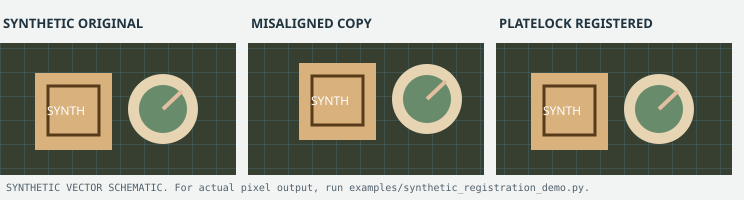

# Platelock

Locks an AI-generated clean plate onto original footage for VFX compositing. Produces STMaps for
Nuke's STMap node.

This is a work in progress. The core pipeline (tracking, reconstruction, microlock, hole-fill,
STMap export) is built and has shipped real deliverables, but it's still under active development.
Expect rough edges.

## Upstream technology and OSF's contribution

**PlateLock is an integration and VFX-registration pipeline, not an original tracking model.** Its correspondence and mask-estimation branches use independent third-party research and software, including [CoTracker3 (Meta)](https://github.com/facebookresearch/co-tracker), [TAPNext / TAPIR (Google DeepMind)](https://github.com/google-deepmind/tapnet), [RoMa](https://github.com/Parskatt/RoMa), [SEA-RAFT](https://github.com/princeton-vl/SEA-RAFT), and Meta's SAM family where configured. Classical OpenCV algorithms and Nuke's STMap conventions also underpin the workflow.

OSF's contribution is the **application, integration and engineering around these existing components**: combining correspondences with robust fitting, temporal microlock, occlusion handling, STMap export, diagnostics and reproducible tests. OSF does not claim to have developed the upstream trackers, models or algorithms. **The MIT licence applies only to OSF-authored repository code.** Some dependencies, notably CoTracker3, have non-commercial restrictions; check the actual deployed model and [third-party licence review](THIRD_PARTY_LICENSES.md) before commercial use.

## Synthetic before/after registration demonstration



The illustration is a **synthetic schematic**, not a frame from LifeR.
For actual pixel output, run the [CPU-only registration demo](docs/try-registration-demo.md).
It generates a three-panel PNG from invented graphics, deliberately shifts
them, then uses **PlateLock's real backward-map functions** to restore their
alignment. The known +16/-10 pixel translation has zero mean absolute pixel
error after correction in a conservative interior crop. This verifies map
direction on an easy known transform, **not** real-world tracked registration,
complex camera motion or temporal stability.

## Quick start

```bash
# 1. Set up environment (only needed once, fixes the Blackwell cu128 requirement)
bash scripts/setup_env.sh

# 2. Activate
source env/platewarp/bin/activate

# 3. Smoke test (5 synthetic frames)
bash scripts/smoke_test.sh

# 4. Run on real footage
python scripts/run_benchmark.py \
  --original /path/to/shot/original.mp4 \
  --clean /path/to/shot/clean.mp4 \
  --out output/some_shot \
  --methods cotracker_mesh dual_video ecc \
  --config configs/full_quality.yaml
```

For the production tracking pipeline (the more developed path, config-driven):

```bash
python -m platelock.run --config platelock/configs/tracking_multikey13.yaml --out output/run_example
```

### Smoke testing and acceptance boundaries

**Recorded clean-environment smoke, 19 August 2026 (historical):**
a fresh virtual environment with the pinned cu128 PyTorch and harness
dependencies completed the five-frame `ecc`, `searaft` and
`cotracker_mesh` methods and wrote the expected metrics and previews.
All three actually executed on **CPU fallback** because that test host had
no NVIDIA GPU attached. The setup and individual results were documented
at the time in [RUNPOD.md, Validation](RUNPOD.md#validation-this-pass-2026-08-19).
This was a real integration test, unlike the lightweight synthetic-stub
CI, but **it is not new execution, CUDA validation, measured VRAM usage,
runtime benchmarking or visual-quality acceptance**. The GPU smoke and
representative production tracking evaluation remain outstanding.

`bash scripts/smoke_test.sh` generates five synthetic original/clean image
pairs in a **new** `output/smoke_tests/run_*/` directory for each invocation.
It runs ECC, SEA-RAFT and CoTracker mesh and exits **nonzero** if any method
fails or omits native `method_result.json` metadata for the expected five
frames. Earlier versions printed `FAIL` but could still exit zero, so
automation should use the current wrapper's process status.

This is a **real model/GPU-dependent integration test**. It can require large
weights, CUDA and separately licensed tracking models; it is not executed
by the public CI workflow. A PASS demonstrates that all three methods
returned the expected metadata, not that STMaps are visually acceptable.

Public CI runs only `bash -n` and seven synthetic command-stub tests from
`tests/test_smoke_wrapper.py`, requiring no original footage, models,
Python packages or GPU. Those tests verify that the wrapper fails closed
on incomplete output and preserves distinct run directories.

For a dated account of what has actually been tested, including input
dimensions, frame counts, CPU-only results and **unmeasured GPU VRAM/runtime**,
see the [tested-environments and evidence register](docs/tested-environments.md).
A installed CUDA build or synthetic CI pass must not be mistaken for
GPU inference or production image-quality acceptance.

## Method tiers (benchmark harness)

| Tier | Method | Type | Status | Notes |
|------|--------|------|--------|-------|
| **1** | `cotracker_mesh` | CoTracker3 tracks, RANSAC, piecewise affine | Ready | Best immediate production path |
| **1** | `tapnext_mesh` | TAPNext++/BootsTAPNext tracks, same fitter | Needs install | `pip install -e repos/tapnet[torch]` |
| **2** | `roma_v2` | RoMa v2 direct orig/clean dense matching | Needs install | `pip install romatch` |
| **3** | `mast3r` | 3D-grounded geometry matching | Future wave | For parallax-heavy shots |
| **4** | `flowseek` | FlowSeek (ICCV 2025) dense residual flow | Needs install | `pip install ptlflow` |
| **4** | `searaft` | SEA-RAFT dense residual flow | Needs install | `pip install ptlflow` |
| Baseline | `dual_video` | Phase correlation dual-video | Ready | Good classical baseline |
| Diagnostic | `ecc` | ECC translation only | Ready | Sanity check, not for final use |
| Diagnostic | `farneback` | LK+RANSAC per-frame | Ready | Classical smoke test |

**CoTracker3 is CC-BY-NC 4.0, non-commercial only.** RoMa, SEA-RAFT, FlowSeek, and PTLFlow are
Apache-2.0 or MIT. See `THIRD_PARTY_LICENSES.md`.

## Architecture

All track-based methods share the same downstream fitter (`scripts/utils/robust_fit.py`):

```
original sequence
  -> SAM2/SAM3 or diff mask (scripts/utils/mask_utils.py, platelock/masks.py)
  -> dense background point grid
  -> CoTracker3 or TAPNext++ tracks (within original and within clean)
  -> RANSAC outlier rejection
  -> model ladder: translation -> affine -> piecewise affine
  -> temporal smoothing
  -> STMap EXR/NPY -> Nuke STMap node
```

RoMa v2 uses the same fitter but with per-frame direct correspondences instead of tracks. The
`platelock/` package is the more developed, config-driven production pipeline: tracking, dense
reconstruction, temporal microlock smoothing, occlusion hole-fill, and 5K export, built around YAML
recipes in `platelock/configs/`.

## Metrics

PSNR/SSIM are logged but are **not the primary quality signal**. A method that improves PSNR but
adds 0.5px temporal jitter is a failure for compositing.

Compositing-appropriate metrics (`scripts/utils/compositing_metrics.py`):

| Metric | What it measures |
|--------|-------------------|
| `mean_chamfer_px` | Mean px distance between background Canny edges. Lower is better lock. |
| `mean_edge_recall_2px` | Fraction of original bg edges within 2px of warped edges. |
| `mean_jerk` | 2nd derivative of warp magnitude. Higher means swimming/jitter. |
| `mean_stmap_grad_u/v` | Spatial gradient of STMap channels. Higher means discontinuities. |

## GPU requirement

Development targeted an NVIDIA RTX PRO Blackwell card (sm_120). System torch builds tied to older
CUDA versions cannot run on sm_120; `scripts/setup_env.sh` creates a fresh venv with cu128 PyTorch.

## Run on Runpod

This pipeline was built and tuned on Runpod GPU pods. `scripts/setup_env.sh` and
`requirements.lock.txt` give a pinned, tested setup path; `RUNPOD.md` has the full deployment
guide, including recommended GPU class, dependency reproducibility details, persistent-volume
guidance, and an honest record of what's actually been validated (and what hasn't, such as GPU
execution when the sandbox doing the validating had no GPU attached).

## Nuke STMap convention

STMaps are exported as `.npy` float32 arrays (H x W x 2).

- **Backward map**: for each *output* pixel, stores the UV coordinate to sample from the source.
- **U** (channel 0) = source X / W, range [0, 1], left to right.
- **V** (channel 1) = 1 minus (source Y / H), a V-flip since Nuke's origin is bottom-left.
- Use R=U, G=V in Nuke's STMap node.

To use in Nuke: load the `.npy`, write to a 16/32-bit EXR (R=U, G=V), connect to an STMap node, use
as Source, apply to the clean plate.

## Adding new methods

All methods must implement:

```python
def process_sequence(self, originals: list, cleans: list, show_progress=True) -> dict:
    # Returns: warped_frames, flows, stmaps, debug_per_frame, method_name
```

Feed correspondences through `scripts/utils/robust_fit.fit_robust()` so all methods stay comparable.

## Configs

| Config | Use for |
|--------|---------|
| `configs/debug_5frames.yaml` | Fast 5-frame sanity check |
| `configs/fast.yaml` | 30 frames, half-res, quick comparison |
| `configs/default.yaml` | Standard nightly run: Tier 1 plus baselines |
| `configs/full_quality.yaml` | Final quality assessment, all tiers |
| `platelock/configs/*.yaml` | Production tracking pipeline recipes, see comments in each |

## SAM3 mask segmentation (optional)

`platelock/segmenters/sam3_segmenter.py` and the `platelock/configs/dense_crux*.yaml` masking
option use Meta's SAM3 model. Set `PLATELOCK_SAM3_CHECKPOINT` to your checkpoint's path, or edit the
`checkpoint:` field directly in the config you're using. This is opt-in and disabled by default in
most configs.

## What's not included

This is a code-only export from an internal working directory. Deliberately excluded:

- `output/`, `input/`, `env/`, `logs/`: real render outputs, real source footage, and the local
  Python virtual environment
- A set of early, superseded Cython prototype files that predate this package and were never wired
  into the shipped pipeline
- Internal session/decision-log notes

## Known limitations

Still under active development, published as it stands rather than as a finished deliverable.

- The benchmark harness (`scripts/`) and the production pipeline (`platelock/`) are related but
  separate systems that grew somewhat independently; some duplication between them hasn't been
  reconciled.

## Acknowledgments

Development and GPU compute for this project happen in collaboration with Runpod. The
Blackwell-class cards this pipeline was built and tuned against came from Runpod pods. See
`RUNPOD.md` for a tested setup path on a Runpod pod.

## License

Open Source Films' own code in this repository (everything except the third-party dependencies
listed below) is released under the MIT License. See `LICENSE`.

This pipeline depends on third-party libraries and models at runtime, several of which are
non-commercial or otherwise restricted, most notably CoTracker3 (CC-BY-NC 4.0). See
`THIRD_PARTY_LICENSES.md` before any commercial deployment.
